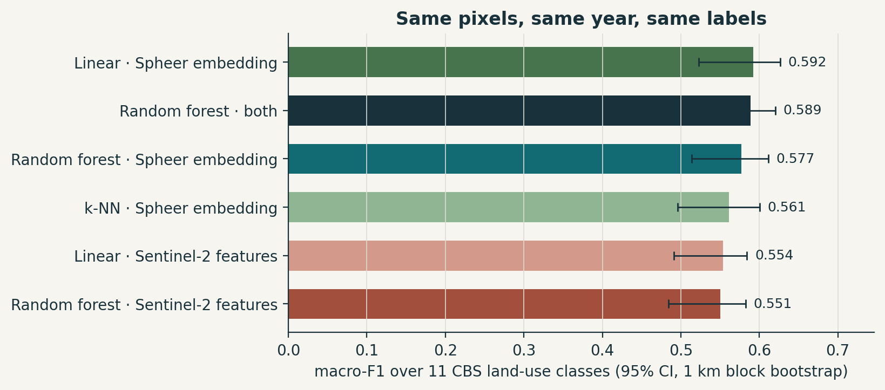

# Is there an embedding better than a random forest?

*Experiment 01 in the [Posts](../README.md) series. Prompted by a reflection on ECCV 2026.*

**TL;DR.** On the same 20 m pixels of the Lelystad coast, with the same year and the same CBS land-use labels, a plain **linear model on a precomputed foundation-model embedding beat a well-fed random forest on 46 hand-built Sentinel-2 features**. Macro-F1 was 0.592 vs 0.551. The paired difference is +0.041, with a 95% CI of +0.006 to +0.066. So yes, but by a few points, not a leap. The embedding also needed far fewer labels: with 50 labelled pixels per class it beat the forest trained on 1,000. It doesn't win everywhere: it's clearly better on classes defined by *use* (sports grounds, parks, shops) and clearly worse on wet nature.

---

## Context

A post from ECCV 2026 quoted one line that I haven't been able to shake:

> "I just wish there would be an embedding which is better than a random forest."

That line sums up three years of geospatial foundation models. We keep publishing models that win on benchmarks, and then practitioners go back to a random forest on band medians because it works, it's cheap and it's theirs. The same post praised *precomputed* Earth embeddings as a compute-equitable way to scale. The model runs once, and everybody else downloads vectors instead of pixels.

I happen to have a precomputed embedding on my disk: the [Spheer FM](https://huggingface.co/datasets/spheer/spheer-fm-embeddings) annual Sentinel-2 embedding for the Netherlands, 100 numbers per pixel. I also have the thing a random forest would be up against at CBS: the official land-use map. So I ran the comparison the quote asks for.

## Hypothesis

1. **H1:** A linear classifier on the Spheer embedding scores at least as well as a random forest on hand-engineered Sentinel-2 features, for CBS land-use classes, under spatially blocked validation.
2. **H2:** The advantage grows as labels get scarce. This is the usual promise of a foundation model.
3. **H3:** The advantage concentrates in classes that are about *context and use*, not spectra: a park is grass plus paths plus trees in a certain arrangement, while a lake is just dark in the near-infrared.

## Data

| | |
|---|---|
| **Area** | 11.2 × 11.5 km on the Lelystad coast (Markermeer, Marker Wadden, Houtribdijk, the town of Lelystad), MGRS tile 31UFU, EPSG:32631, 20 m grid (561 × 574 px). This is the one Spheer extract I have locally; the embeddings are large and download at ~0.4 MB/s, so I didn't fetch another. |
| **Embedding** | Spheer FM Albatross, 2020, 100-d per pixel, read at its 20 m overview. Nothing else. |
| **Raw baseline** | Sentinel-2 L2A for 2020 from Microsoft Planetary Computer: 64 scenes under 60% cloud, **56 clear dates** after masking cloud, shadow and cirrus with the scene classification layer. Each scene was resampled onto *exactly* the Spheer grid. |
| **Labels** | CBS NBBG2020 land use (public, CC BY 4.0), rasterised onto the grid. Pixels whose 3 × 3 neighbourhood mixes classes are dropped, leaving **297,911 pure pixels**. |
| **Classes** | 11 classes with at least 300 pure pixels in at least 3 blocks: residential, retail & catering, industry & business, park, sports grounds, forest, dry nature, wet nature, Markermeer, recreational water, other inland water. Agriculture, roads, construction, allotments and day recreation exist here but have too few pure pixels and were dropped. |

One honest warning: **89% of the window is the Markermeer.** Overall accuracy is therefore meaningless (every model scores about 0.96 by recognising water), so everything below uses **macro-F1**, the unweighted mean F1 over the 11 classes.

## Method

**Features.**
- *Random forest side:* the textbook recipe, built in [`src/experiment.py`](src/experiment.py). Quarterly median reflectance for 10 bands (Q1–Q4), quarterly median NDVI, and the annual 10th and 90th NDVI percentiles: 46 features.
- *Embedding side:* the 100 Spheer numbers, untouched.

**Models.**
- Random forest (500 trees) on S2, on Spheer, and on both.
- Logistic regression on S2 and on Spheer, both standardised.
- k-NN (k = 15, cosine) on Spheer.

None were tuned, so no model got special treatment.

**Validation.**
- The scene is cut into 1 km blocks. Blocks are dealt into 5 folds (seed 24), and a **100 m buffer** around each test fold is removed from training.
- Each fold trains on a class-balanced sample of up to 2,000 pixels per class. Every pixel is predicted by a model that never saw its block.
- Confidence intervals come from a **paired** bootstrap over blocks. Both models are scored on the same resampled blocks, so a hard block counts against both. That's the right test for "is A better than B on the same data". The unpaired intervals in the bar chart overlap, but they mostly measure which blocks are hard.

**Label efficiency.** The same folds, but training on 5, 10, 25, 50, 100, 250 or 1,000 pixels per class, with 5 random draws each.

## Results



| model | macro-F1 | paired Δ vs RF on S2 [95% CI] |
|---|---|---|
| Random forest · Sentinel-2 (46 features) | 0.551 | baseline |
| Linear · Sentinel-2 | 0.554 | +0.003 [−0.019, +0.024] |
| k-NN · Spheer | 0.561 | +0.011 [−0.015, +0.041] |
| Random forest · Spheer | 0.577 | +0.026 [+0.009, +0.046] |
| Random forest · Spheer + S2 | 0.589 | +0.039 [+0.022, +0.054] |
| **Linear · Spheer** | **0.592** | **+0.041 [+0.006, +0.066]** |

**H1 holds, modestly.** A 100-to-11 linear map on the embedding beats the forest, and the difference survives the paired bootstrap. Three details I find more interesting than the headline:

- *The gain is the representation, not the classifier.* A linear model on the S2 features ties the forest (+0.003). Swapping the features is what moves the needle.
- *The forest adds little on top of the embedding.* RF on Spheer is below linear on Spheer. Most of what the classes need is already linearly readable from the 100 numbers.
- *The raw bands add nothing once you have the embedding.* RF on both (0.589) ≈ linear on Spheer alone (0.592).


**H2 doesn't hold.** I expected the gap to widen with fewer labels. It doesn't: it stays at roughly 0.03–0.04 macro-F1 at every budget from 5 to 1,000 pixels per class (5 draws each; shaded = ±1 sd). The practical statement is still striking, though: **linear on Spheer with 50 labelled pixels per class (0.579) beats the random forest with 1,000 (0.548).** Twenty times fewer labels for a better map.


**H3 holds, and it has a flip side.**

| class | RF on S2 | linear on Spheer | Δ |
|---|---|---|---|
| sports grounds | 0.33 | 0.57 | **+0.25** |
| retail & catering | 0.04 | 0.18 | +0.14 |
| park | 0.51 | 0.64 | +0.13 |
| industry & business | 0.64 | 0.70 | +0.06 |
| wet nature | 0.86 | 0.72 | **−0.14** |
| dry nature | 0.49 | 0.46 | −0.04 |

The embedding wins on exactly the classes a photo-interpreter recognises by *arrangement*: a sports field is grass with lines next to a car park, and a park is grass with paths and scattered trees. It loses on wet nature, the reed and marsh of the Marker Wadden. My guess, which I haven't tested: that class is defined by hydrology over the season (flooded in winter, green in summer), which the quarterly features spell out explicitly and an annual 100-d summary may compress away.


## Thoughts

- **The quote has an answer, at least here.** Yes, there's an embedding better than a random forest, and the best way to use it is the *simplest* head you can fit. That's the encouraging part for practitioners: no fine-tuning, no GPU, a model that trains in seconds.
- **"Better" is a few F1 points, not a new era.** Absolute macro-F1 is about 0.59 for every model. CBS classes describe *land use*: "retail" and "public facilities" are legal and functional categories that 20 m pixels can only partly see. No representation of the pixels fixes a label that isn't in the pixels.
- **Compute-equitable, but not download-equitable.** The embedding saved me the Sentinel-2 pipeline: STAC search, cloud masking, compositing, feature design. But it moved the cost to the download. A single tile-year of Spheer at full resolution is about 50 GB, and I could only afford one small window at 20 m. Precomputed embeddings are only equitable if they come with cheap, windowed access.
- **Use both, per class.** The per-class flip suggests the right production setup isn't "embedding instead of features" but embedding plus a few physically meaningful seasonal features, kept for exactly the classes where seasonality is the signal.
- **I'd now like to see it where it matters for my work:** agriculture and construction, both absent from this window. That needs another extract, and that's the next experiment.

## Limitations

- **One window, one year.** 11 × 11.5 km, mostly water, 11 classes. The intervals cover block-to-block variation inside this window, not other regions.
- **20 m, not the native 10 m.** Both sides used the same grid, but small urban classes would likely benefit from 10 m.
- **Untuned models.** Defaults for everything (500 trees, C = 1, k = 15). A tuned forest might close part of the gap; so might a tuned probe.
- **Pure pixels only.** Mixed boundary pixels are dropped, which flatters every model equally but makes the task easier than a wall-to-wall map.

## Model on Hugging Face

The probe is on the Hub as [**AthithyaLogan/spheer-nbbg-linear-probe**](https://huggingface.co/AthithyaLogan/spheer-nbbg-linear-probe): 11 × 100 weights in safetensors plus a standardiser, applied with plain numpy (no pickle). The model card states that it was trained on one window and won't transfer without refitting.

## Reproduce

```bash
pip install -r ../requirements.txt
# needs access to the gated spheer/spheer-fm-embeddings dataset (see Spheer_EM for the reader)
python src/fetch_s2.py   --spheer <cache>/markermeer_31UFU_2020_ov1.npz            # ~200 MB, ~5 min
python src/experiment.py --spheer <cache>/markermeer_31UFU_2020_ov1.npz \
       --s2 data/s2_2020_scenes.npz --nbbg2020 <CBS_Publicatiebestand_NBBG2020_v3_def.gpkg>   # ~16 min CPU
python src/figures.py    --spheer <cache>/markermeer_31UFU_2020_ov1.npz --s2 data/s2_2020_scenes.npz
python src/export_hf.py
```

Seeds are fixed (24); re-running reproduces every number above exactly (checked). Outputs are in [`results/`](results/): `metrics.json` (all models, CIs, paired deltas, class pixel counts), `per_class_f1.csv`, `label_efficiency.csv` and `s2_scene_log.json` (every Sentinel-2 scene ID, its clear fraction, and whether it was kept).
