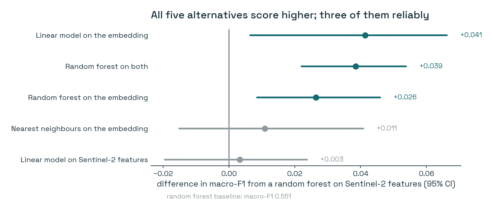
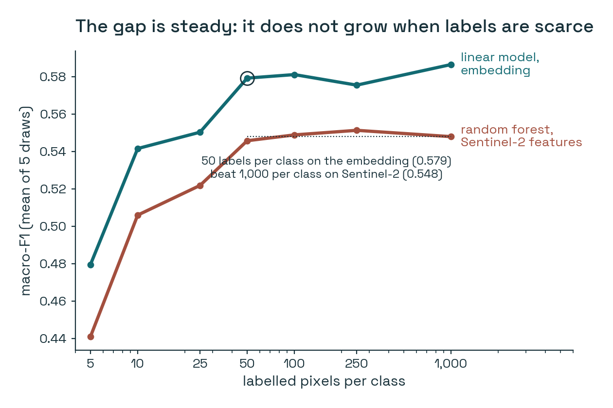
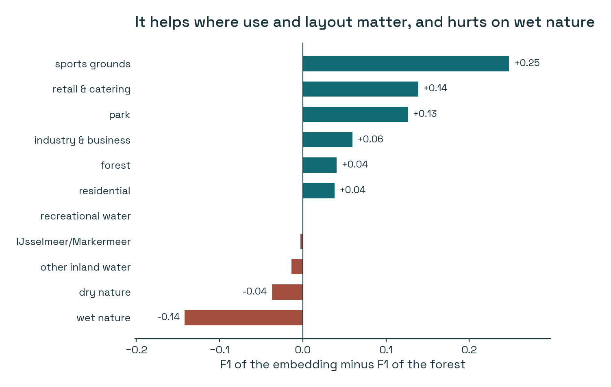
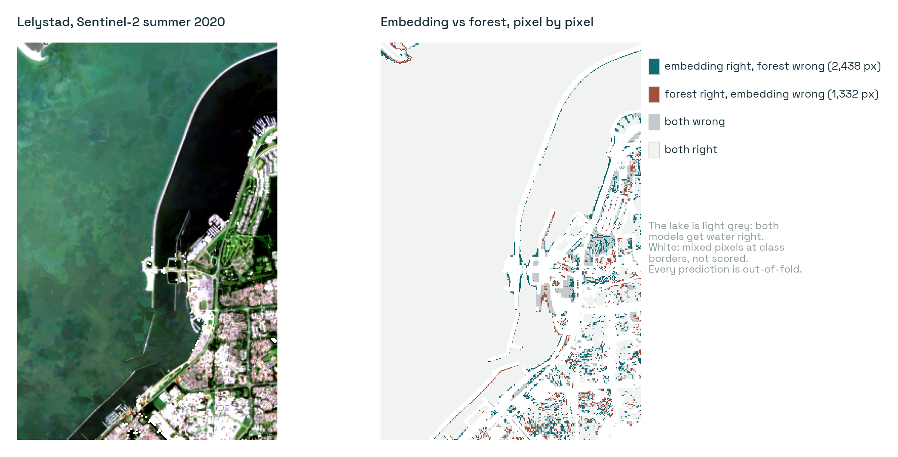

# Is there an embedding better than a random forest?

*Experiment 01 in the [Posts](../README.md) series: small experiments that test an idea from my feed against my own work.*

---

Someone wrote a reflection on ECCV 2026 that's been circulating in my corner of LinkedIn. One line in it, overheard in a conversation at the conference, has stuck with me since:

> "I just wish there would be an embedding which is better than a random forest."

I laughed when I read it, and then I stopped laughing, because it describes my field rather precisely. For three years we've been building geospatial foundation models. They top the benchmarks. And when real work needs doing (a land-cover map for a ministry, a habitat layer for an ecologist), people quietly go back to a random forest on a few band medians. It's cheap, it's well understood, and it works.

The same post was hopeful about *precomputed* Earth embeddings: run the big model once, publish the vectors, and let everyone else skip the expensive part. That idea is close to my heart. I work on land use for official statistics, where the budget for GPUs is roughly zero and the budget for "it has to be right" is very high.

I happen to have a precomputed embedding on my disk, and I happen to have the map a random forest would be up against in my job. So I set up the comparison the quote is asking for.

## A fair fight

The embedding is [Spheer FM](https://huggingface.co/datasets/spheer/spheer-fm-embeddings): a foundation model trained on Sentinel-2 that summarises a whole year of satellite observations into 100 numbers per pixel. It's large and slow to download, so I only have one extract: an 11 × 11.5 km window on the Lelystad coast, for 2020, at 20 m.

The labels are the official **CBS land-use map** for the same year (NBBG2020). This is not a land-*cover* map. It doesn't just say "grass"; it says "park", "sports ground", "residential". That makes it hard, and that's exactly why I wanted it.

For the random forest, I built what any remote-sensing course would teach. I downloaded every Sentinel-2 scene of 2020 over the same window (56 dates clear enough to use), masked the clouds, and computed seasonal medians of every band plus vegetation indices: 46 features per pixel, on exactly the same 20 m grid as the embedding.

Then the rules that keep me honest:
- **Same pixels, same year, same labels** for every model.
- **No random pixel splits.** Neighbouring pixels are nearly identical, so a random split lets the model peek at the answer. Instead, I cut the area into 1 km blocks, held out whole blocks, and kept a 100 m buffer around them out of training.
- **No tuning for anyone.** Every model ran with sensible defaults.

One caveat up front, because it shapes everything else: **89% of this window is the Markermeer lake.** Every model gets the water right, so overall accuracy is useless here (everyone scores about 0.96). I compare models on macro-F1 instead, which gives each of the 11 land-use classes an equal say.

## The answer



**Yes, the embedding wins.** A plain linear model on the 100 embedding numbers reaches macro-F1 **0.592**. The random forest on 46 hand-built features reaches **0.551**.

That's a difference of **+0.041**. To check it isn't luck, I resampled the blocks a thousand times and scored both models on the same draws every time. The 95% interval for the difference runs from +0.006 to +0.066. It doesn't include zero, so the win is real. It's also not a leap: four points of F1.

Two things in this figure surprised me more than the headline did.

**The win comes from the representation, not the classifier.** A linear model on the Sentinel-2 features is no better than the forest (+0.003). Swapping the *inputs* is what moves the result.

**The simplest head was the best one.** A random forest on the embedding does slightly worse than a straight line on it. Whatever the land-use classes need is already sitting in those 100 numbers, readable with a ruler.

## The part I expected to be dramatic

The usual promise of a foundation model is that it needs fewer labels. I fully expected the gap to widen as I gave both models less training data. So I retrained them with 5, 10, 25, 50, 100, 250 and 1,000 labelled pixels per class:



It didn't widen. The embedding stays about three to four points ahead all the way from 5 labels to 1,000. That's a less exciting story than I hoped for, and I think it's worth saying out loud.

But look at it from the other side, because that's how a practitioner would. **The embedding with 50 labelled pixels per class beats the random forest with 1,000.** If labels are what you pay for, and in my world they are, that's twenty times less labelling for a slightly better map.

## Where it helps, and where it doesn't

The average hides the most useful part. Here is the difference per class:



The embedding wins big on **sports grounds (+0.25), shops (+0.14) and parks (+0.13)**. These are classes defined by *arrangement and use*. A sports field is grass with white lines next to a car park. A park is grass with paths and scattered trees. A single pixel's colour can't tell you that; the neighbourhood can. My reading is that the embedding has learned something about neighbourhoods.

It loses clearly on **wet nature (−0.14)**, the reed beds and marshes of the Marker Wadden. That class is defined by water over the seasons: flooded in winter, green in summer. My seasonal features spell that out explicitly, quarter by quarter. A single annual summary may smooth it away. That's a hypothesis I haven't tested, but it fits.

On the map, the pattern is visible. Teal is where only the embedding was right, clay where only the forest was:



Across the town, the embedding fixes about 2,400 pixels the forest got wrong, and breaks about 1,300 that the forest got right. It's better, but not uniformly better.

## What I make of it

**So, is there an embedding better than a random forest?** Here, yes. And the best way to use it was the simplest one: no fine-tuning, no GPU, a model that trains in seconds. I find that genuinely encouraging. That's the version of a foundation model a statistics office can actually adopt.

**But "better" is four points, not a new era.** Every model in this comparison lands around 0.55 to 0.6. The CBS classes describe what land is *used for*: "retail" or "public facilities" is a legal and functional category, and a 20 m pixel can only see part of it. No representation of the pixels can recover a label that isn't in the pixels.

**"Compute-equitable" moved my cost rather than removing it.** The embedding saved me the whole Sentinel-2 pipeline: searching scenes, masking clouds, compositing, designing features. But a single year of one tile at full resolution is about 50 GB, and at the download speed I get, I could only afford one small window. Precomputed embeddings are only as equitable as the access to them.

**The per-class split is the real lesson for practice.** It suggests the answer isn't "embedding *instead of* features" but embedding *plus* a handful of physically meaningful seasonal features, kept for exactly the classes where seasonality is the signal.

What I really want to see next is agriculture and construction. Those are the classes my work depends on, and this window has almost none of either. That needs another extract, and another evening.

---

<details>
<summary><strong>How I did it (data, models, numbers, limitations)</strong></summary>

**Area.**
- 11.2 × 11.5 km on the Lelystad coast (Markermeer, Marker Wadden, Houtribdijk, Lelystad).
- MGRS tile 31UFU, EPSG:32631, 20 m grid of 561 × 574 px.

**Embedding.** Spheer FM Albatross, 2020, 100-d, read at its 20 m overview. The dataset is gated on Hugging Face.

**Sentinel-2 baseline.**
- Source: Microsoft Planetary Computer, collection `sentinel-2-l2a`. 64 scenes under 60% cloud on tile 31UFU, of which 56 dates were usable after masking with the scene-classification layer (cloud, shadow, cirrus, no-data). Every scene was resampled onto the Spheer grid.
- 46 features: quarterly medians of 10 bands, quarterly median NDVI, and annual NDVI 10th/90th percentiles.

**Labels.**
- CBS NBBG2020 (public, CC BY 4.0), rasterised onto the grid.
- Pixels whose 3 × 3 neighbourhood mixes classes are dropped: 297,911 pure pixels remain.
- Classes need at least 300 pure pixels in at least 3 blocks, which leaves 11. Agriculture, roads, construction, allotments and a few others are present but too small here.

**Models.**
- Random forest (500 trees) on S2, on the embedding, and on both.
- Logistic regression on standardised S2 and on the embedding.
- k-NN (k = 15, cosine) on the embedding.
- Training sample: class-balanced, up to 2,000 pixels per class per fold.

**Validation.** 1 km blocks dealt into 5 folds (seed 24), with a 100 m buffer around each test fold removed from training. The intervals are a paired bootstrap over blocks (1,000 resamples).

| model | macro-F1 | paired difference vs RF on S2 [95% CI] |
|---|---|---|
| Random forest, Sentinel-2 | 0.551 | baseline |
| Linear, Sentinel-2 | 0.554 | +0.003 [−0.019, +0.024] |
| k-NN, embedding | 0.561 | +0.011 [−0.015, +0.041] |
| Random forest, embedding | 0.577 | +0.026 [+0.009, +0.046] |
| Random forest, both | 0.589 | +0.039 [+0.022, +0.054] |
| **Linear, embedding** | **0.592** | **+0.041 [+0.006, +0.066]** |

**Limitations.**
- One window, one year, mostly water.
- 20 m rather than the native 10 m.
- Untuned models.
- Pure pixels only, which makes the task easier than a wall-to-wall map for every model equally.

**Model on Hugging Face.** The linear probe is [AthithyaLogan/spheer-nbbg-linear-probe](https://huggingface.co/AthithyaLogan/spheer-nbbg-linear-probe): 11 × 100 weights in safetensors, applied with plain numpy (no pickle).

**Reproduce.**

```bash
pip install -r ../requirements.txt
python src/fetch_s2.py   --spheer <cache>/markermeer_31UFU_2020_ov1.npz      # ~200 MB, ~5 min
python src/experiment.py --spheer <cache>/markermeer_31UFU_2020_ov1.npz \
       --s2 data/s2_2020_scenes.npz --nbbg2020 <CBS_Publicatiebestand_NBBG2020_v3_def.gpkg>   # ~16 min CPU
python src/figures.py    --s2 data/s2_2020_scenes.npz
python src/export_hf.py
```

Seeds are fixed, and re-running reproduces every number exactly (checked). Results are in [`results/`](results/), including every Sentinel-2 scene ID used.

</details>
