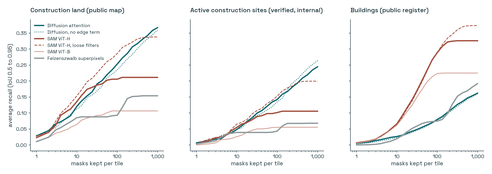
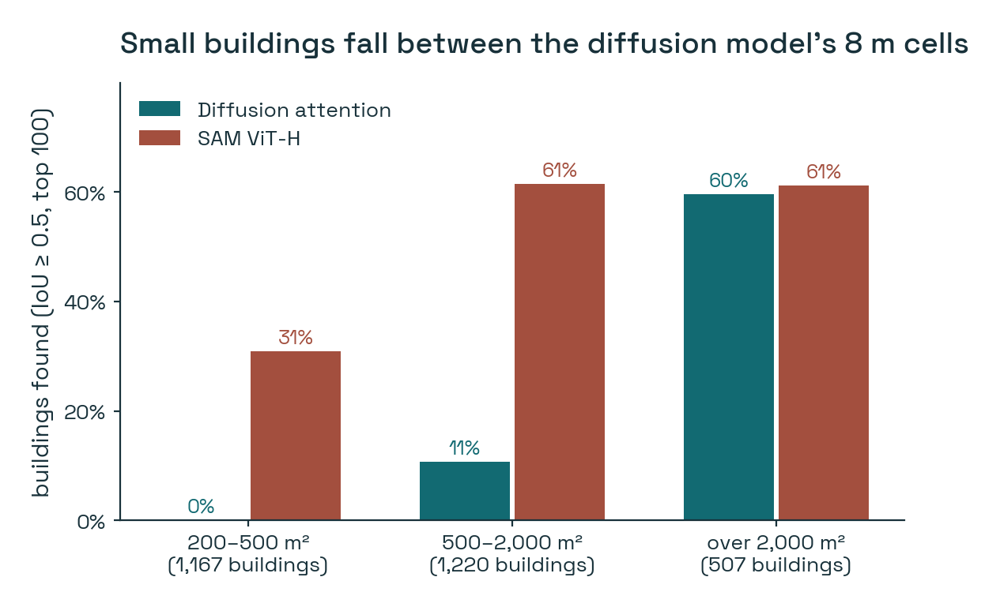
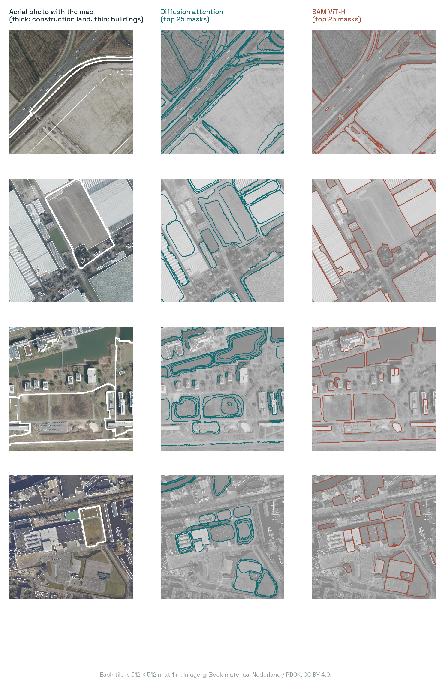

# Can an image generator find construction sites without being shown one?

*Experiment 02 in the [Posts](../README.md) series.*

---

Every construction site my detector knows about was drawn by a person. Somebody at CBS sat in front of an aerial photo, recognised bare earth, spoil heaps and foundations, and traced the outline. That's what makes the map trustworthy, and it's also what makes it expensive. Labels are the slowest part of everything I build.

The best general-purpose answer to "find the objects in this image" is Segment Anything (SAM). It got there by learning from 11 million images and more than a billion masks. That's a recipe nobody can repeat for a new domain.

There's an intriguing alternative. Text-to-image diffusion models, the kind that generate pictures from a prompt, have to understand where one object ends and the next begins in order to draw anything coherent. Nobody gave them masks; the structure emerged from learning to generate images. A recent paper, **Diffuse2Seg**, uses exactly that. It reads the model's internal attention, turns it into masks without any labels, and reports beating earlier label-free mask generators by 4 to 7 points.

If that holds on Dutch aerial imagery, it would matter for me. So I tried it.

## 1. Hypotheses

1. **H1.** Diffusion-attention masks find construction sites, which are large, irregular regions with soft edges, better than SAM does.
2. **H2.** SAM finds buildings, which are small objects with crisp edges, better than diffusion attention does.
3. **H3.** Both clearly beat a classical method that uses no deep learning at all.
4. **H4.** The "edge-preserving" part of the method, which the paper's abstract emphasises, measurably improves the masks.

## 2. The three contenders

**Diffusion attention: my reimplementation of the Diffuse2Seg idea.** No code has been published, so I built it from the abstract. Every choice the abstract doesn't pin down is mine, and they're listed in section 8.
- **Model:** Stable Diffusion 2.1 base. Its denoising UNet has about 865M parameters, frozen. The original repository was removed from Hugging Face, so I used the community mirror `sd2-community/stable-diffusion-2-1-base`.
- **Reading the attention:** the tile is encoded to the model's 64 × 64 internal grid, lightly noised (step 100 of 1000), and passed through the UNet once with an empty prompt. I record the self-attention maps, which say how much each grid cell "looks at" every other cell.
- **Point prompts:** a 16 × 16 grid of seed points is spread through that attention, with a mild colour-similarity term so the spread prefers to stay within regions of similar colour. That's my reading of "edge-preserving".
- **Masks:** thresholding the spread at several levels gives masks from small parts to whole objects. They're deduplicated, ranked by how stable they are, and refined back to full resolution with a guided filter that follows edges in the photo.
- **Cost:** 12.4 s per tile and 2.5 GB of GPU memory.

**Segment Anything (SAM).** Meta's model, trained on the SA-1B dataset, in automatic mask mode: a 32 × 32 grid of point prompts, with masks kept if SAM is confident and they're stable. I ran:
- **ViT-H**, about 640M parameters, 3.6 s per tile
- **ViT-B**, about 90M parameters, 2.5 s per tile
- **ViT-H with loose filters** (quality thresholds lowered from 0.88/0.95 to 0.5/0.7), 5.7 s per tile, to check whether SAM was being held back by its own strictness

**Felzenszwalb superpixels.** A classic graph-based segmentation from 2004, at three scales. No training, no GPU, 0.8 s per tile. It's here so that "better than nothing" has a number.

## 3. Data: an open benchmark

I built a benchmark from public data only, and published it so anyone can rerun this: [AthithyaLogan/nl-aerial-proposal-bench](https://huggingface.co/datasets/AthithyaLogan/nl-aerial-proposal-bench).
- **Tiles:** 200 aerial photos of 512 × 512 m at 1 m per pixel, from the 2022 Dutch national orthophoto (PDOK). Each tile is centred on a randomly drawn construction area somewhere in the Netherlands.
- **Ground truth, two kinds:**
  - **Construction land**: every area mapped as construction site (class 34) in the public CBS land-use map of 2022. That's 264 objects in the test tiles.
  - **Buildings**: every building footprint of at least 200 m² in the national building register (BAG). That's 2,912 objects in the test tiles.
- **A third, private check:** construction sites that CBS interpreters verified as *active*, 215 objects. It's used for scoring only, never published or drawn.
- **Splits:** the first 20 tiles were used to choose the diffusion settings, and every reported number comes from the other 180.

## 4. Method

1. **Every method proposes masks for every tile with no labels at all.** Nothing is trained in this experiment.
2. **Scoring: average recall (AR).** For every real object, I find the best-matching mask among a method's top *K* masks and measure how well they overlap (IoU). AR averages the share of objects found over overlap thresholds from 0.5 to 0.95. A score of 1 means every object found with a perfect outline. I report it at K = 100 masks per tile (a realistic budget) and K = 1,000 (the paper's choice).
3. **Paired comparison.** To compare two methods, I resample the 180 test tiles 1,000 times and score *both* methods on the same resampled tiles. The interval of the difference tells me whether it's real.
4. **Choosing settings fairly.** The diffusion model's two free settings (noise step and colour term) were chosen on the 20 development tiles only. SAM and Felzenszwalb ran at their standard settings.

## 5. Results



| AR@100 (AR@1000) | Felzenszwalb | Diffusion | SAM ViT-B | SAM ViT-H | SAM ViT-H, loose |
|---|---|---|---|---|---|
| Construction land | 0.09 (0.15) | 0.25 (**0.37**) | 0.11 (0.11) | 0.21 (0.21) | **0.29** (0.34) |
| Active sites (internal) | 0.04 (0.07) | 0.14 (**0.25**) | 0.06 (0.06) | 0.10 (0.11) | **0.15** (0.20) |
| Buildings | 0.07 (0.19) | 0.08 (0.16) | 0.22 (0.23) | **0.29** (0.33) | **0.29** (**0.37**) |

### 5.1 Construction sites: it depends on how you hold SAM (H1: partly)

Against SAM at its standard settings, diffusion attention clearly wins on construction land: **+0.047** AR@100 (95% interval +0.017 to +0.079). This is where I first thought the story was.

Then I loosened SAM's filters. Out of the box, SAM throws away any mask it isn't confident about and keeps only about 140 per tile. With looser thresholds it keeps about 380, and it **overtakes diffusion** at 100 masks per tile: −0.033 for diffusion (−0.064 to −0.002). Diffusion only edges back ahead at 1,000 masks per tile (+0.029, +0.001 to +0.059), because it produces many more masks and some of them happen to cover a large site well.

On the verified active sites the picture is the same, a draw at 100 masks and a small diffusion win at 1,000.

### 5.2 Buildings: not close (H2: yes)

SAM ViT-H finds buildings far better: diffusion trails by **−0.21** AR@100 (−0.23 to −0.19). The reason is clearest by size:



On buildings over 2,000 m², the two are equal (60% vs 61%). On buildings of 200–500 m², diffusion finds **none**. The diffusion model sees the tile through its 64 × 64 internal grid, so each cell covers 8 × 8 m, and a typical house occupies two or three cells. There's no mask small enough to draw it.

### 5.3 Against no deep learning at all (H3: mostly)

Diffusion attention beats Felzenszwalb by a wide margin on construction land (+0.16, +0.12 to +0.20), but **not on buildings**: a tie at 100 masks, and slightly worse at 1,000 (−0.030). SAM beats Felzenszwalb everywhere.

### 5.4 The edge-preserving term (H4: no clear effect)

On the development tiles, a *strong* colour term made things worse, and a weak one looked slightly better. On the test tiles, the weak one is +0.018 AR@100 on construction land, but the interval (−0.001 to +0.039) includes zero. I can't claim it helps. In my implementation, the edge awareness that matters seems to come from the guided-filter refinement at the end, not from the attention step.

### 5.5 What the masks look like



Left: the photo with the map (thick outline: construction land; thin: buildings). Middle: the 25 best diffusion masks. Right: the 25 best SAM masks. Diffusion draws soft, rounded regions that follow large homogeneous areas: a field, a cleared plot, a lake. SAM draws crisp, angular objects: roofs, car parks, greenhouse blocks. Each one is good at what it was built for.

## 6. Reflections

1. **The first result was an artefact of default settings.** Diffusion beating SAM on construction sites felt like the headline. It disappeared the moment I loosened SAM's quality filter. I'll be checking defaults before I believe a comparison from now on, including my own.
2. **The metric quietly picks the winner.** The paper reports recall at 1,000 masks per image. At that budget a method that proposes many masks gets many chances, and diffusion does win there. At 100, a budget a person might actually review, it doesn't. Neither number is wrong, but they answer different questions.
3. **Resolution is a physical limit, not a tuning problem.** An 8 m grid can't produce a 15 m house. For aerial imagery at 1 m, the diffusion approach is a "large regions" tool. That's still useful, since construction sites *are* large regions, but it isn't "segment anything".
4. **For my work, the practical answer today is SAM with looser filters.** It's the best or tied-best on everything at the realistic budget, it's twice as fast, and it's open. Diffusion attention is an interesting complement for big, soft-edged areas, not a replacement.
5. **I tested only the first half of the paper.** The paper's bigger claim is that a segmentation model *trained* on these label-free masks beats one trained on real labels after only 5,000 labelled images. That's the experiment that would really matter for a statistics office. It's also the obvious next step.

## 7. Limitations

1. **This is my reading of an abstract, not the authors' method.** Details I had to choose (which attention layers, how seeds spread, thresholds, ranking) could all differ from theirs, and better choices may exist. The numbers describe my implementation.
2. **One image source.** One year (2022) of Dutch orthophotos at 1 m. Other resolutions, especially sharper ones, would change the building result.
3. **Imperfect ground truth.** The construction class includes serviced but empty plots, which look like grass and are mapped by rule, not by sight. So some of the "missed" construction land has nothing visible to find. Building footprints come from a register, not the roof outline, so they can be offset slightly from the image.
4. **Small development set.** The two diffusion settings were chosen on 20 tiles. Better values may exist.

## 8. Details and reproduction

<details>
<summary><strong>Implementation details, development-tile results, and how to rerun it</strong></summary>

**Diffusion-attention proposer** ([`src/proposers.py`](src/proposers.py)):
- *Model:* SD 2.1 base, fp16. The tile is VAE-encoded to 4 × 64 × 64, noised with DDPM at t = 100 (fixed seed), and passed through the UNet once with the empty-prompt text embedding.
- *Attention:* self-attention maps captured from every transformer block at 64² and 32² resolution and averaged over heads and layers. The 32² maps are lifted to 64² (queries copied, keys spread), and the two resolutions are averaged with equal weight.
- *Colour term:* attention multiplied by exp(−‖Δ Lab colour‖² / 2σ²), with σ = 32, then row-normalised.
- *Seeds:* a 16 × 16 grid, propagated 1, 2 and 4 steps, each normalised to its maximum. Thresholds 0.2, 0.35 and 0.5. Only the connected component containing the seed is kept.
- *Ranking and dedup:* score = stability (mask area at τ+0.08 divided by area at τ−0.08) × (1 − e^(−area/16)). Greedy non-maximum suppression at IoU 0.85, up to 1,000 masks.
- *Refinement:* heat map upsampled bilinearly to 512 px, then a guided filter (r = 8, ε = 10⁻³) before re-thresholding.

**Development tiles** (AR@100 for construction land / buildings):

| noise step t | σ = 8 | σ = 16 | σ = 32 | no colour term |
|---|---|---|---|---|
| 25 | | | 0.167 / 0.093 | 0.174 / 0.092 |
| 50 | | | 0.163 / 0.089 | 0.170 / 0.089 |
| 100 | 0.078 / 0.068 | 0.141 / 0.087 | **0.230 / 0.087** | 0.207 / 0.088 |
| 300 | 0.063 / 0.062 | 0.141 / 0.070 | | 0.156 / 0.051 |
| 500 | 0.037 / 0.048 | 0.093 / 0.056 | | 0.100 / 0.012 |

**SAM:** Hugging Face `transformers` mask-generation pipeline with `facebook/sam-vit-huge` and `facebook/sam-vit-base`, default 32 × 32 point grid, `points_per_batch` 64. Default filters are `pred_iou_thresh` 0.88 and `stability_score_thresh` 0.95; the loose run uses 0.5 and 0.7.

**Felzenszwalb:** scikit-image, scales 800, 200 and 50, σ = 0.8, minimum size 50 px.

All paired differences are in [`results/summary.json`](results/summary.json).

**Reproduce** (one GPU job at a time; about 3 hours in total on an 8 GB laptop GPU, tuning included):

```bash
pip install -r ../requirements.txt
python src/build_tiles.py --nbbg2022 <CBS_Publicatiebestand_NBBG2022_v1_def.gpkg> --n 200   # ~15 min, public data
python src/tune.py                                                                          # dev tiles only
python src/run.py --method diffusion --t 100 --sigma 32 --split test
python src/run.py --method sam_h --split test
python src/run.py --method sam_h_recall --split test
python src/run.py --method sam_b --split test
python src/run.py --method felz --split test
python src/run.py --method diffusion --t 100 --sigma inf --split test   # the colour-term ablation
python src/summarize.py --methods diffusion_t100_s32 diffusion_t100_sinf sam_h sam_h_recall sam_b felz
```

Or skip `build_tiles.py` and download the benchmark from [Hugging Face](https://huggingface.co/datasets/AthithyaLogan/nl-aerial-proposal-bench).

</details>
