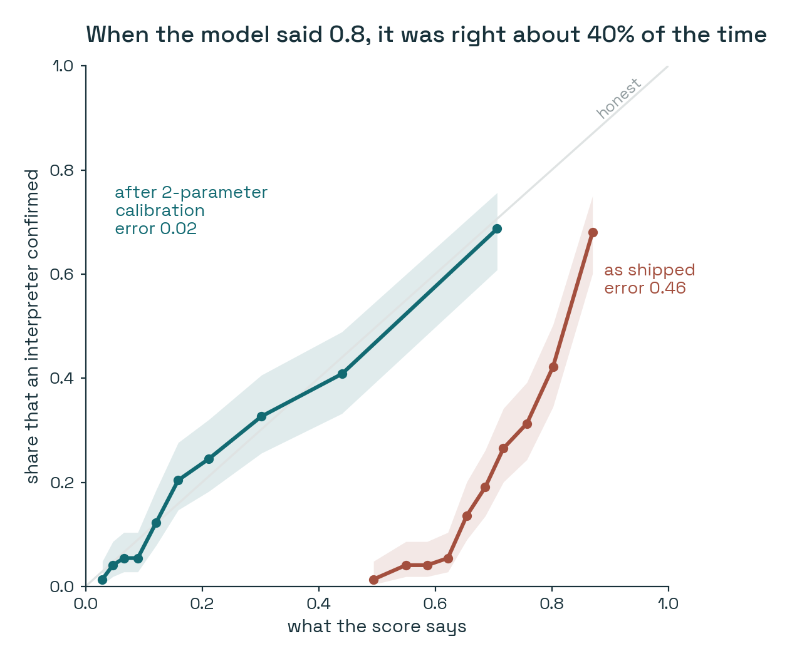
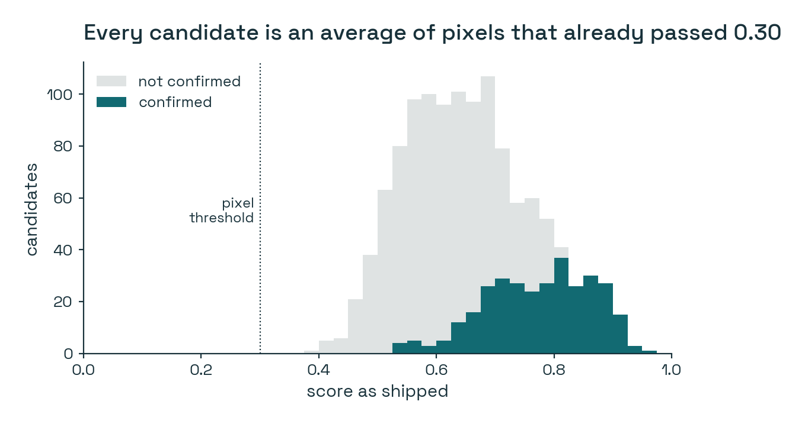
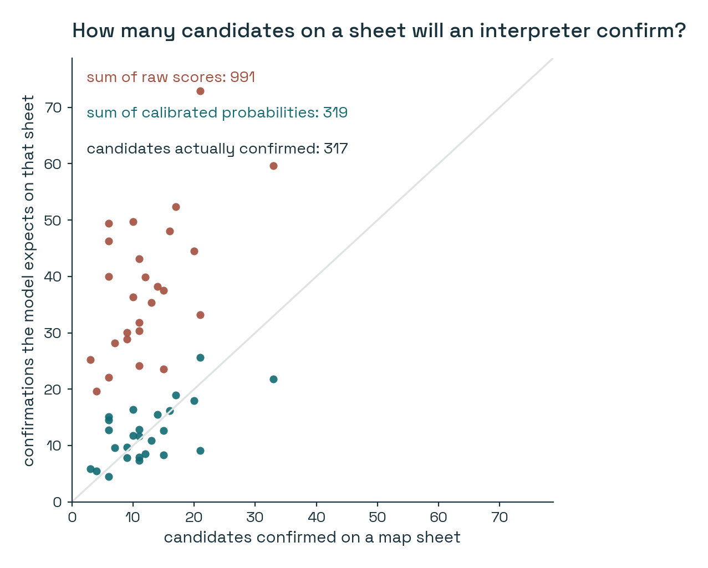

# My model said 0.8. It meant 0.4.

*Experiment 03 in the [Posts](../README.md) series: small experiments that test an idea from my feed against my own work.*

---

A post about Google's [Agricultural Landscape Understanding](https://developers.google.com/agricultural-understanding/understanding-data) (ALU) went past my feed this week. ALU maps fields, ponds, wells and trees from satellite imagery. What caught my eye is a design detail most people would scroll past: every feature it publishes comes with an ID, an area, and a **confidence between 0 and 1**.

That's the right design. Someone downstream can sort by it, filter by it, or add it up. And it made me slightly uncomfortable, because my own system does exactly the same thing, and I had never checked whether my number meant anything.

## The number I never questioned

For the past months I've been building [BT24](https://github.com/athithyai/bt24-bouwterrein), a model that looks at Dutch aerial photos and flags places that look like active construction sites. It isn't meant to replace anyone. It produces a candidate list for the photo-interpreters who maintain the CBS land-use map, so they can spend their time on likely sites instead of scanning whole map sheets.

Every candidate it outputs carries a `confidence` column. I wrote the line of code that computes it. It takes the average probability of the pixels inside the polygon. I used it to sort the list, and I never asked the obvious follow-up:

**If I hand someone a polygon that says 0.8, will it be a real construction site 80% of the time?**

## Checking it

The check itself is simple. For the 2024 test sheets I have something precious: interpreters went through the map and verified which construction sites are actually active. So I took all **1,470 candidates** BT24 produced on those **26 map sheets** and asked of each one: did an interpreter confirm it?

**317** were confirmed. That's 22%.

The average confidence on those same candidates was **0.67**.

That gap is the whole story, but it's more striking as a picture. I sorted the candidates by their score, cut them into ten equal groups, and compared what the score said with how often it was right:



If the score were honest, the dots would sit on the grey diagonal. The clay line is what I had actually shipped. Candidates scored around 0.55 were confirmed about 4% of the time. Candidates scored around 0.8 were confirmed about 42% of the time. Even the most confident tenth, averaging 0.87, was right only 68% of the time.

The reason turned out to be in my own code, and it's almost embarrassing once you see it:



A pixel only becomes part of a candidate if its probability is above 0.30. The confidence is then the average of those pixels. So a candidate *can't* have a low score; the lowest in the whole set is 0.39. The score is a perfectly reasonable way to *rank* candidates. It was simply never a probability, and nothing in how I built it forced it to be one.

## The fix is two numbers

There's a standard remedy called **calibration**. You learn a small function that maps the raw score onto the share of candidates that actually turn out to be right. The simplest version, Platt scaling, has two parameters. I fitted it on four-fifths of the map sheets and tested it on the rest, rotating until every sheet had been tested once, so no sheet was ever scored by a calibrator that had seen it.

That's the teal line in the first figure. The calibration error drops from **0.46 to 0.02**. The ranking barely changes (AUC 0.823 → 0.819), which makes sense: I didn't make the model any smarter, I just made it tell the truth about itself.

## Why this matters more than it sounds

For an interpreter working through a sorted list, it doesn't matter much. Top of the list is top of the list.

But the moment a number is printed in an attribute table, somebody will do arithmetic with it. And for a statistics office, arithmetic is the point. The most natural thing to do with a column of probabilities is add it up. If every candidate on a map sheet has a probability, the sum is how many confirmations you should expect on that sheet before anyone opens it.



Adding up my original scores predicted **991** confirmed candidates. The interpreters confirmed **317**. Every single sheet was overestimated, by about three times.

Adding up the calibrated probabilities predicted **319**. On a typical sheet the estimate is off by about 4 candidates in either direction, with no systematic bias. That's a number you can plan review work around.

One thing to be careful about: this counts *candidates that turn out to be real*, not construction sites. One site can be hit by two candidates, and some sites aren't flagged at all (these 26 sheets hold 420 verified sites). So it tells you how much true work is in the list, not the true amount of construction. Getting from one to the other is a separate problem.

## A small surprise

BT24 has a second stage: a re-ranker that looks at context the detector can't see, such as what the land was two years earlier, what's around the polygon, and whether it overlaps a farm parcel. I checked its scores too, fully expecting the same problem.

It was already calibrated (error 0.02), before I touched it. In hindsight this isn't mysterious. It's a classifier trained to predict *probabilities* on exactly this kind of data, so that's what it learned to produce. The detector's score was assembled by hand. The lesson I take from it: **scores you compute are not probabilities unless something trained them to be.**

## What I'm taking away

- **A confidence column is a promise to whoever reads the table.** I treated it as a sort key, which is how *I* used it. But I'm not the only reader, and the other readers will add it up.
- **Calibration was the cheapest improvement this project has had.** No new data, no retraining, no GPU. Two parameters and one honest plot. I wish I'd drawn that plot on day one.
- **It will drift, and I'll need to keep checking.** The biggest lesson BT24 has taught me so far is that a model trained on one flight year can quietly break on the next, and a calibrator is a model too. My plan is to refit the two parameters every year on the interpreter review set. Two parameters can be estimated from a few dozen reviewed candidates; anything more flexible would need far more.

And to bring it back to ALU: I don't know whether Google's confidence values are calibrated. But now I know which question to ask of any dataset that ships with one.

---

<details>
<summary><strong>How I did it (methods, numbers, limitations)</strong></summary>

**Data.**
- BT24 candidates on the 2024 test sheets: 1,601 polygons on 26 map sheets (12.5 × 10 km each).
- 131 lie on serviced-but-unbuilt plots or are below the 1 ha minimum mapping unit. CBS mapping rules exclude those, so they're neither right nor wrong and are left out. That leaves 1,470.
- A candidate counts as confirmed if it overlaps a site an interpreter verified as active in 2024.
- The labels are CBS-internal, so the repository contains code and aggregates only.

**Validation.** 5 folds of whole map sheets (seed 24). Neighbouring candidates share a flight, a season and often a building project, so a random split would leak. Every number here is out-of-fold. The intervals are a bootstrap over whole sheets (2,000 resamples).

| score | AUC | calibration error (ECE) [95% CI] | Brier |
|---|---|---|---|
| detector, as shipped | 0.823 | 0.458 [0.421, 0.491] | 0.348 |
| detector + Platt (2 parameters) | 0.819 | 0.022 [0.019, 0.050] | 0.129 |
| detector + isotonic | 0.811 | 0.024 [0.018, 0.054] | 0.128 |
| re-ranker, untouched | 0.879 | 0.022 [0.017, 0.053] | 0.104 |

ECE is the average gap between stated and observed rate over 10 equal-size groups of candidates.

**Limitations.**
- One year and 26 sheets. The intervals cover sheet-to-sheet variation, not other years.
- "Confirmed" means the candidate overlaps a verified site, which is generous: clipping a corner counts. It's the same rule for every score compared.

**ALU-style export.** [`src/alu_schema.py`](src/alu_schema.py) writes each candidate as a GeoJSON feature in ALU's pattern:
- a plus-code ID of the centroid (10 digits, exact integer arithmetic, checked against the reference example `8FVC9G8F+6X`)
- the area
- the raw score
- a calibrated `p_site`, so that `sum(p_site)` is an estimate rather than a guess

**Reproduce.**

```bash
pip install -r ../requirements.txt
python src/calibrate.py --candidates <BT24>/data/cand_2024_test_feat_scored.csv
python src/alu_schema.py --candidates <BT24>/data/cand_2024_test_feat_scored.csv \
    --geometry <BT24>/data/cand_2024_test.gpkg --out data/candidates_alu.geojson
```

About 20 seconds on a laptop CPU. The figures are drawn by the same script. Aggregates are in [`results/`](results/), with sheet IDs anonymised.

</details>
